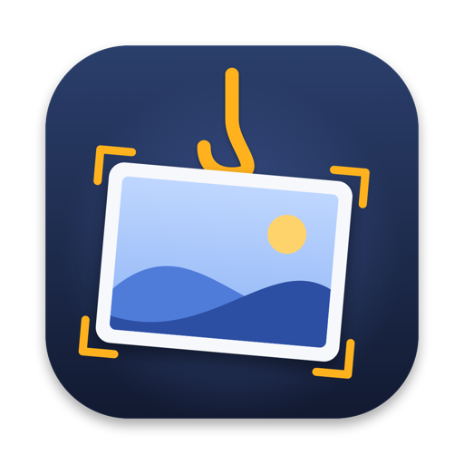

<p align="center">
  
</p>

<h1 align="center">Hangshot</h1>

<p align="center">
  Every screenshot you take hangs on a line at the top of your screen.<br>
  Copy it, drag it, mark it up or toss it, without ever opening Finder.
</p>

<br>

Hangshot is a tiny macOS menu bar app. It never takes screenshots itself.
You keep using ⌘⇧3, ⌘⇧4, ⌘⇧5 or any other tool, and each new capture
flies up to a line hanging just below the menu bar. When you need one,
push the pointer against the top edge of the screen and the line slides
down. Move away and it tucks itself back up.

## What happens when you take a screenshot

1. macOS saves the file. Hangshot notices it within a fraction of a second.
2. The screenshot flies from where you took it to the line, which drops
   down for 2.5 seconds so you see it land, then tucks away.
3. It stays on the line until you take it down. The line adapts to what it
   carries: the rope sags deeper as it fills, and the cards draw closer and
   shrink (down to 60%) so more fit. It holds 9 to 21 screenshots depending
   on screen width. When it is full, the oldest one falls off the end. Its
   file is not deleted.

## What you can do with a screenshot on the line

| Action | Result |
|:--|:--|
| Click | Copies the image to the clipboard, ready to paste. |
| Press and hold | Opens it in Markup to annotate. |
| Double click | Opens it in your default image app, usually Preview. |
| Drag into an app | Sends a copy (Slack, Mail, a browser, an editor...). It stays on the line. |
| Drag into a folder or the Desktop | Moves the file there and takes it off the line. |
| Drag to the Trash, or click the ✕ in its corner | Discards it. |
| Right click | Copy, Open, Markup, Show in Finder. Plus Save to Desktop and Discard for screenshots in Hangshot's folder, or Take down and Move to Trash for files elsewhere. |
| Click the circle in a card's top right corner | Picks it. Pick several, then drag any picked card to drag them all at once, as one pile. |
| Click **Clear all** at the right end of the line | Discards every screenshot at once. |

**Discarding** depends on where the file lives. A screenshot in Hangshot's
own folder (see *Handle screenshots* below) goes to the Trash, so you can
still recover it. A screenshot anywhere else, like your Desktop, only comes
off the line; its file stays where it is.

## Showing and hiding the line

| Action | Result |
|:--|:--|
| Push the pointer against the top edge for ¼ second | The line comes down on that screen, if anything hangs on it. An empty line stays up. |
| Move the pointer away for ½ second | It tucks back up. |
| Click anything in the menu bar | It tucks away, so it never covers a menu. |
| <kbd>⌃</kbd> <kbd>⌥</kbd> <kbd>T</kbd>, or **Show line** in the menu | Shows or hides it on purpose, even when empty. |

While the line is tucked away it leaves no window behind, so nothing
invisible sits over the top of your screen. It also works over full screen
apps (a full screen browser, editor or Claude window), which you can turn
off from the menu.

## The menu bar menu

| Item | What it does |
|:--|:--|
| Show line / Hide line | Same as <kbd>⌃</kbd> <kbd>⌥</kbd> <kbd>T</kbd>. |
| Take everything down | Takes every screenshot off the line, one after another. |
| Handle screenshots | See below. Offered once on first launch. |
| Hang copied images | Also hangs images you copy. Off until you turn it on. Offered once on first launch. |
| Show over full screen apps | Lets the line come down over full screen apps. On by default. |
| Open screenshots folder | Opens the folder Hangshot is watching. |
| Sounds | The small sounds when a screenshot lands or is discarded. |
| Open at login | Starts Hangshot when you log in. |

## Handle screenshots

Without this mode, Hangshot watches the folder macOS already saves
screenshots to (the Desktop by default). On the Desktop it only picks up
files macOS has tagged as screenshots, never your other images.

With **Handle screenshots** on, Hangshot changes these macOS screenshot
settings, the same ones behind ⌘⇧5 → Options:

| Setting | Changed to | Why |
|:--|:--|:--|
| Save location | `~/Library/Application Support/Hangshot/Screenshots` | Screenshots stop piling up on your Desktop. |
| Floating thumbnail | Off | The file is written at once instead of 5 seconds later. |
| Save to | File | Clipboard or Preview would write no file to hang. |

(The save location is written under both its old and its macOS 27 name.)

Your previous values are saved first and put back when you turn the mode
off, quit Hangshot, log out, or when it is stopped with a signal. To keep
a screenshot, drag it to a folder or use **Save to Desktop**. Screen
recordings also follow the save location, but only images hang on the
line, so Hangshot moves each new `.mov` / `.mp4` back to where your
captures went before (the Desktop by default).

## Hang copied images

Off unless you turn it on. When on, Hangshot checks the clipboard twice a
second. If you copy an image, like a screenshot taken with <kbd>⌃</kbd>
held or **Copy Image** in a browser, it is saved as a PNG in Hangshot's
folder and hangs on the line. Copying image files in Finder hangs those
files. Text is never kept, and anything a password manager marks as
concealed or transient is skipped. Clicking a screenshot on the line to
copy it does not hang it a second time.

## Privacy

No account, no network access, no analytics. Hangshot reads only the
screenshot folder, and the clipboard if you turn that on. Everything
stays on your Mac. macOS asks once for access to your Desktop folder,
which is where screenshots land by default.

## Windows and Linux

Hangshot also runs on Windows 10/11 and Linux, as a separate app built on
Qt: [`windows-linux/hangshot.py`](windows-linux/hangshot.py). Download it
from the [latest release](../../releases/latest), or run it from source:

```sh
pip install PySide6
python windows-linux/hangshot.py
```

It works the same way: the line at the top of the screen, click to copy,
double click to open, drag out (one screenshot or a picked group), the
selection circle, Clear all, the adaptive line, and a right click menu
with Copy, Open, Show in folder, Take down and Move to Trash. Its menu
lives in the system tray (click the icon to show or hide the line), with
*Choose screenshots folder…* and *Start at login*.

It watches `Pictures/Screenshots`, where Windows (Win+PrtScn, Snipping
Tool) and GNOME and KDE save screenshots, plus its OneDrive copy on
Windows and, on Linux, files named like screenshots in `Pictures`.

What is different from the Mac app:

- No *Handle screenshots* mode, no Markup and no keyboard shortcut. The ✕
  and Clear all only take screenshots off the line; their files stay put.
  *Move to Trash* in the right click menu deletes one.
- On Wayland, apps cannot read the pointer or place their windows, so
  Hangshot runs through XWayland when it can. Where it cannot, use the
  tray icon to show the line.
- The release builds are not code signed, so Windows SmartScreen asks
  once before running it (More info → Run anyway).

## Install on a Mac

Hangshot for the Mac is built from source for now.

```sh
git clone https://github.com/GHGuide/hangshot.git
cd hangshot
scripts/build-app.sh
cp -R build/Hangshot.app /Applications/
open /Applications/Hangshot.app
```

Requires macOS 14 Sonoma or later and the Swift toolchain (Xcode or the
Command Line Tools). The script builds one app for Apple silicon and Intel.
It signs with a Developer ID from your keychain if it finds one, and
otherwise signs ad hoc, in which case macOS asks again for Desktop access
after each rebuild.

## How it is built

The Mac app is Swift, AppKit and SwiftUI, with no dependencies. The
Windows and Linux app is one Python file on Qt (PySide6), with a
`--self-test` that GitHub runs on Windows and Linux on every push before
building the release downloads.

| File | Role |
|:--|:--|
| `AppDelegate.swift` | Menu bar item, showing and hiding the line, pointer tracking |
| `ScreenshotWatcher.swift` | Watches the screenshot folder for new files |
| `Inbox.swift` | The *Handle screenshots* mode and the macOS settings it changes |
| `ClipboardWatcher.swift` | *Hang copied images* |
| `Line.swift` | The screenshots on the line: hanging, copying, discarding |
| `LineView.swift`, `PeggedView.swift` | Drawing the line, the cards and the Clear all button |
| `GrabArea.swift` | Clicks, long press, drag and drop on each card |
| `CaptureFlight.swift` | The flight from where you took a screenshot to the line |
| `LinePanel.swift`, `FullScreen.swift` | The floating window and full screen detection |
| `Markup.swift`, `HotKey.swift` | Markup and the <kbd>⌃</kbd> <kbd>⌥</kbd> <kbd>T</kbd> shortcut |
| `windows-linux/hangshot.py` | The whole Windows and Linux app |

Text in the app is translated into English, Spanish and Simplified
Chinese (`Sources/Hangshot/Resources`). `swift scripts/check-strings.swift`
checks that every string is translated.

## Credits

Hangshot is based on [Tendedero](https://github.com/alejandrobujan/tendedero)
by Alejandro Buján, released under the MIT License. It is a separate
project with its own name and icon, and is not affiliated with or endorsed
by Tendedero's author.

It includes changes first proposed to Tendedero by
[Anubhav-Rai](https://github.com/Anubhav-Rai) (no window left behind while
the line is tucked away; hanging copied images) and
[rickardstureborg](https://github.com/rickardstureborg) (the line comes
down from the top edge only).

New in Hangshot: the Windows and Linux app, picking several screenshots
to drag out together, a line that adapts to how many it holds, the Clear
all button, the line over full screen apps, an empty line that stays up,
screen recordings sent back out of the screenshots folder, and *Save to*
switched to File while handling screenshots.

## License

MIT, see [LICENSE](LICENSE).
